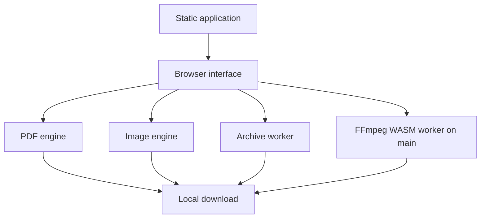

<div align="center">

<picture>
  <source media="(prefers-color-scheme: dark)" srcset="public/brand/logo-horizontal-light.png" />
  <source media="(prefers-color-scheme: light)" srcset="public/brand/logo-horizontal-dark.png" />
  
</picture>

# Gravipress

**Engineered to be smaller.**

Privacy-first file compression, directly in your browser.

[](https://gravipress.pages.dev/)
[](https://github.com/cgupta21/gravipress)
[](https://gravipress.pages.dev/)
[](https://gravipress.pages.dev/)

[**Launch Gravipress v1.0**](https://gravipress.pages.dev/) · [Report an issue](https://github.com/cgupta21/gravipress/issues) · [Production branch](https://github.com/cgupta21/gravipress/tree/release/v1.0-non-multimedia)

</div>

> **Branch note:** This `main` branch hosts active multimedia development (video and audio compression via self-hosted WebAssembly FFmpeg). The live non-multimedia **v1.0 production release** is deployed from [`release/v1.0-non-multimedia`](https://github.com/cgupta21/gravipress/tree/release/v1.0-non-multimedia) at [https://gravipress.pages.dev/](https://gravipress.pages.dev/).

## Overview

Gravipress is a browser-based file compression toolkit for documents, images, archives, and (on `main`) audio and video. Its industrial olive (`#2b2d21`), silver (`#d9dadc`), and yellow (`#ffc93c`) hydraulic-press interface connects visual feedback with real compression progress. File processing takes place locally on the user's device, without an application server, account, or remote file storage.

## Features

| Capability         | Production v1.0 (`release/v1.0-non-multimedia`)                          | Development (`main`)                                                |
| ------------------ | ------------------------------------------------------------------------ | ------------------------------------------------------------------- |
| PDF compression    | Structural optimization and adaptive image-based compression             | Included                                                            |
| Image optimization | Quality controls, aspect-ratio resizing, and target-size optimization    | Included                                                            |
| Batch processing   | Up to 20 files (100 MB combined), with progress, cancellation, and retry | Included                                                            |
| ZIP archives       | Files and nested folders with configurable DEFLATE compression levels    | Included                                                            |
| GZIP               | Single-file `.gz` stream compression                                     | Included                                                            |
| Video compression  | Not included                                                             | In development (`.mp4` H.264/AAC, `.webm` VP8/Vorbis)               |
| Audio compression  | Not included                                                             | In development (MP3, M4A/AAC, Ogg Vorbis, mono Ogg Opus, FLAC, WAV) |
| Local processing   | 100% browser-side execution and direct local downloads                   | Included                                                            |

## Supported formats

| Tool               | Formats                                                                        |
| ------------------ | ------------------------------------------------------------------------------ |
| PDF                | `.pdf` (validated by `%PDF-` header)                                           |
| Images             | `.jpg`, `.jpeg`, `.png`, `.webp`, `.avif` (browser-dependent encoding support) |
| ZIP                | General files and nested folders; `.zip` output                                |
| GZIP               | Single file; `.gz` output                                                      |
| Video (`main` dev) | `.mp4` (H.264 / AAC), `.webm` (VP8 / Vorbis) via single-thread FFmpeg WASM     |
| Audio (`main` dev) | MP3, M4A/AAC, Ogg Vorbis, mono Ogg Opus, FLAC, PCM WAV                         |

Animated `.gif`, APNG, animated WebP, and animated AVIF optimization are not yet supported.

## Compression methods

| Preset   | PDF                                                                                       | Images                                                              |
| -------- | ----------------------------------------------------------------------------------------- | ------------------------------------------------------------------- |
| Light    | Structure-only optimization (`pdf-lib` object streams)                                    | Conservative quality (`0.90`); lossless PNG re-encoding (`upng-js`) |
| Balanced | Structural optimization first, then ~144 DPI (`0.75` JPEG) with bounded adaptive fallback | Balanced encoding quality (`0.78`) and PNG palette quantization     |
| Maximum  | Structural optimization first, then ~96 DPI (`0.50` JPEG) with bounded adaptive fallback  | Aggressive quality (`0.55`) and palette reduction                   |

The PDF engine compares valid candidates and retains the original file when no smaller valid output is produced. Image target-size mode uses bounded adaptive search (`6` attempts max) and is best-effort rather than guaranteed. ZIP offers **Store only** (`0`), **Fast** (`1`), **Balanced** (`6`), and **Maximum** (`9`) DEFLATE levels via `fflate`.

### Audio presets (`main` development)

| Output                     | MIME         |            Light |         Balanced |          Maximum |
| -------------------------- | ------------ | ---------------: | ---------------: | ---------------: |
| MP3 / `libmp3lame`         | `audio/mpeg` |         256 kbps |         128 kbps |          64 kbps |
| M4A / native AAC           | `audio/mp4`  |         192 kbps |         128 kbps |          64 kbps |
| Ogg / `libvorbis`          | `audio/ogg`  |         192 kbps |         128 kbps |          64 kbps |
| Ogg Opus / `libopus`, mono | `audio/ogg`  |         128 kbps |          96 kbps |          48 kbps |
| Native FLAC                | `audio/flac` |          Level 3 |          Level 5 |          Level 8 |
| WAV / PCM                  | `audio/wav`  | Source precision | Source precision | Source precision |

## Performance & verification

### Historical archive benchmarks (Maximum ZIP / DEFLATE level 9)

| Test fixture          | Space saved |
| --------------------- | ----------: |
| 1 MB technical text   |       88.6% |
| 5 MB telemetry CSV    |       85.0% |
| 10 MB structured JSON |       94.8% |
| 256 KB random binary  |        0.0% |

### Phase 6 video benchmarks (single-threaded FFmpeg WASM)

| Fixture / Workload                                  | Mode & Codec                | Output            | Space saved |
| --------------------------------------------------- | --------------------------- | ----------------- | ----------: |
| Synthetic Animated Video (31.1 KB, 320×240, 25 FPS) | MP4 (H.264 / AAC, CRF 28)   | 9.4 KB (320×240)  |       69.8% |
| Synthetic Animated Video (31.1 KB, 320×240, 25 FPS) | WebM (VP8 / Vorbis, CRF 36) | 11.2 KB (320×240) |       64.0% |
| Muted Video Test (31.1 KB, 320×240)                 | MP4 (H.264, Audio Muted)    | 7.8 KB (320×240)  |       74.9% |

### Phase 7 audio verification (`main` development)

- **Custom Multimedia Core (Build #12)**: Single-thread WebAssembly core based on **FFmpeg 5.1.10 LTS** (pinned commit `19feb712f5c1821d8a3fa1ad63c5bd2e3b9672eb`) with `libvpx` `1.17.0` (resolving CVE-2024-5197, CVE-2025-5283, and CVE-2026-2447). Corresponding source is archived in `public/ffmpeg/ffmpeg-corresponding-source-5.1.10.tar.gz` and cataloged in `public/ffmpeg/manifest.json`.
- **Synthetic 1s 440 Hz mono PCM WAV (88,244 B) Balanced savings**: MP3 `80.5%` (17,180 B), M4A/AAC `83.6%` (14,468 B), Ogg Vorbis `93.1%` (6,053 B), Ogg Opus `81.9%` (15,962 B), FLAC `70.7%` (25,838 B), WAV `88,278 B` (34 bytes larger before original retention).
- **Multi-browser & offline verification**: Reproduce synthetic audio matrix measurements with `node tests/measure-audio.mjs` and browser memory sampling with `node tests/measure-browser-memory.mjs`.

These are previously recorded fixture-specific measurements, not guarantees. Results vary with content, prior compression, device, and browser.

## Privacy and architecture

Gravipress processes selected files locally in your browser. Compression does not upload file contents to a remote server, and no uploaded files are persisted in `localStorage` or `IndexedDB`.



## Technology stack

| Layer                   | Technology                                                                                                         |
| ----------------------- | ------------------------------------------------------------------------------------------------------------------ |
| Interface               | HTML, CSS, JavaScript                                                                                              |
| Build tooling           | Vite (`vite` `^6.0.0`)                                                                                             |
| PDF processing          | `pdf-lib` (`^1.17.1`), `pdfjs-dist` (`^6.5.438`)                                                                   |
| Image processing        | HTML5 Canvas API, `upng-js` (`^2.1.0`)                                                                             |
| Archive processing      | `fflate` (`^0.8.3`), Web Workers                                                                                   |
| Multimedia (`main` dev) | `@ffmpeg/ffmpeg` (`0.12.15`), `@ffmpeg/core` (`0.12.10`), `@ffmpeg/util` (`0.12.2`), custom FFmpeg 5.1.10 LTS WASM |
| Testing & formatting    | Node.js test runner, Playwright (`^1.65.1`), Prettier (`^3.10.1`)                                                  |
| Production v1.0 hosting | Cloudflare Pages (`release/v1.0-non-multimedia`)                                                                   |

## Getting started

### Prerequisites

- Node.js 18 or later (Node.js 22 recommended).
- npm and a modern browser with ES modules, HTML5 Canvas, and Web Worker support.

### Local development

```bash
git clone https://github.com/cgupta21/gravipress.git
cd gravipress
npm ci
npm run dev
```

Open the local URL printed by Vite. To run or build the production v1.0 non-multimedia release instead, check out `release/v1.0-non-multimedia`.

### Testing and building

```bash
npm test
npm run format:check
npm run build
npm run preview
```

For browser E2E testing:

```bash
npx playwright install
npm run test:e2e
```

## Deployment

Public deployment of the multimedia build on `main` is on hold pending licensing/release-gate review. The production v1.0 non-multimedia release is hosted on Cloudflare Pages from `release/v1.0-non-multimedia`:

| Setting              | Value                         |
| -------------------- | ----------------------------- |
| Production branch    | `release/v1.0-non-multimedia` |
| Framework preset     | Vite (or None)                |
| Build command        | `npm run build`               |
| Output directory     | `dist`                        |
| Environment variable | `NODE_VERSION=22`             |
| Production URL       | https://gravipress.pages.dev/ |

## Processing limits and compatibility

| Resource                |                                                                  Limit |
| ----------------------- | ---------------------------------------------------------------------: |
| PDF input               |            100 MB / 200 pages / 8192 px max side / 24 MP rendered page |
| Individual image        |                        50 MB / 8192 px max side / 32 MP decoded pixels |
| Batch queue             |                                             20 files / 100 MB combined |
| Archive input           |     250 files / 100 MB combined / 50 MB single file / 12 folder levels |
| Multimedia (`main` dev) | 50 MiB / 600 seconds / 128 MiB WAV cap / 1 active multimedia operation |

**Important:** Rasterized PDF compression can remove searchable text, links, forms, and accessibility structure. Encrypted PDFs are rejected, and processing signed PDFs may invalidate digital signatures. Image re-encoding strips EXIF/IPTC/XMP metadata and normalizes output to sRGB. AVIF output depends on browser support. On `main`, stereo Ogg Opus is disabled in the current FFmpeg WASM binary, and native MP4/audio playback on Windows WebKit remains unverified on macOS/iOS Safari.

## Project structure

```text
gravipress/
├── public/                     # Static assets, icons, and self-hosted FFmpeg WASM/source
├── src/
│   ├── components/             # Workspace UI controllers (audio, batch, archive)
│   ├── config/                 # Presets and processing limits (PDF, image, video, audio, archive)
│   ├── engines/                # Compression, transcoding, metadata, and preview engines
│   ├── state/                  # Processing queue state
│   ├── utils/                  # File, image, audio, video, path, and download helpers
│   ├── workers/                # Web Workers (archive and FFmpeg video/audio)
│   ├── main.js                 # Application orchestration
│   └── style.css               # Industrial palette and hydraulic press UI
├── tests/                      # Unit tests, Playwright E2E suites, and audio benchmarks
├── index.html                  # Application entry point
├── package.json                # Dependencies and npm scripts
├── playwright.config.js        # Browser test configuration
├── THIRD_PARTY_LICENSES.md     # Third-party dependency and FFmpeg notices
└── vite.config.js              # Build and preview server configuration
```

## Roadmap

- Maintain and improve the production v1.0 non-multimedia release on `release/v1.0-non-multimedia`.
- Complete multimedia testing, Safari native playback verification, and GPL/LGPL dependency licensing review before any public multimedia release.

## Contributing

Bug reports, feature suggestions, and pull requests are welcome. For substantial changes, open an issue first to discuss the proposed approach. Include reproduction steps and browser details when reporting bugs, and use non-sensitive test files. Run `npm test` and `npm run format:check` before submitting changes.

## License

See [THIRD_PARTY_LICENSES.md](THIRD_PARTY_LICENSES.md) for third-party notices and FFmpeg corresponding-source details. Production v1.0 on `release/v1.0-non-multimedia` is MIT-licensed; experimental multimedia dependencies on `main` carry additional LGPL/GPL obligations.

---

<div align="center">

**Gravipress — Less space. More room.**

[gravipress.pages.dev](https://gravipress.pages.dev/)

</div>
