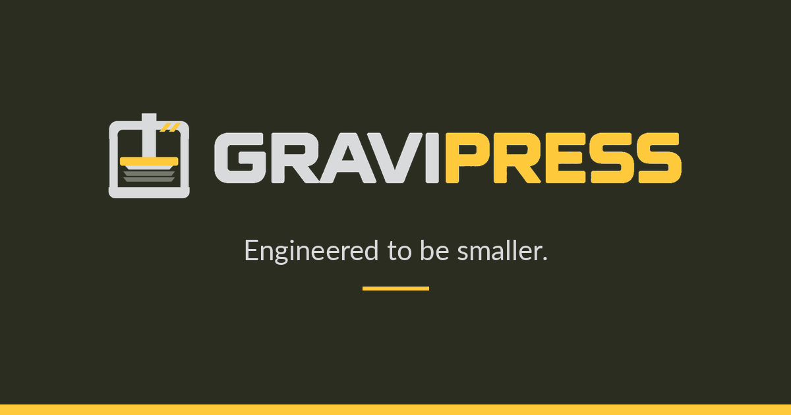
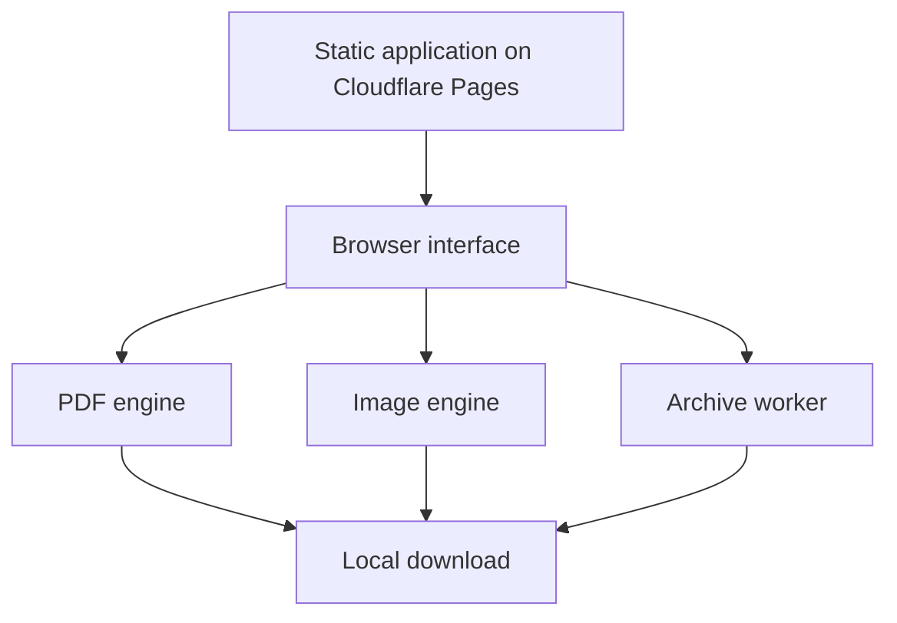

<div align="center">

<picture>
  <source media="(prefers-color-scheme: dark)" srcset="public/brand/logo-horizontal-dark.png" />
  <source media="(prefers-color-scheme: light)" srcset="public/brand/logo-horizontal-light.png" />
  
</picture>

# Gravipress

**Engineered to be smaller.**

Privacy-first file compression, directly in your browser.

[](https://gravipress.pages.dev/)
[](https://github.com/cgupta21/gravipress/actions/workflows/ci.yml?query=branch%3Arelease%2Fv1.0-non-multimedia)
[](LICENSE)
[](https://gravipress.pages.dev/)
[](https://gravipress.pages.dev/)

[**Launch Gravipress**](https://gravipress.pages.dev/) · [Report an issue](https://github.com/cgupta21/gravipress/issues) · [Source code](https://github.com/cgupta21/gravipress/tree/release/v1.0-non-multimedia)

<br />



</div>

## Overview

Gravipress is a browser-based file compression toolkit for PDF documents, raster images, batch queues, and lossless archives. Its industrial olive (`#2b2d21`), silver (`#d9dadc`), and yellow (`#ffc93c`) hydraulic-press interface connects visual feedback with real compression progress. File processing takes place locally on the user's device, without an application server, account, or remote file storage.

## Features

| Capability         | Production v1.0                                                          |
| ------------------ | ------------------------------------------------------------------------ |
| PDF compression    | Structural optimization and adaptive image-based compression             |
| Image optimization | Quality controls, aspect-ratio resizing, and target-size optimization    |
| Batch processing   | Up to 20 files (100 MB combined), with progress, cancellation, and retry |
| ZIP archives       | Files and nested folders with configurable DEFLATE compression levels    |
| GZIP               | Single-file `.gz` stream compression                                     |
| Local processing   | 100% browser-side execution and direct local downloads                   |

Audio and video compression are separate development initiatives and are **not** included in production v1.0 (`release/v1.0-non-multimedia`).

## Supported formats

| Tool   | Formats                                                                        |
| ------ | ------------------------------------------------------------------------------ |
| PDF    | `.pdf`                                                                         |
| Images | `.jpg`, `.jpeg`, `.png`, `.webp`, `.avif` (browser-dependent encoding support) |
| ZIP    | General files and nested folders; `.zip` output                                |
| GZIP   | Single file; `.gz` output                                                      |

Animated image optimization (animated GIF/APNG/animated WebP/AVIF) and standalone multimedia transcoding are not supported in production v1.0. Multimedia files may still be packaged as ordinary files inside ZIP or GZIP archives.

## Compression methods

| Preset   | PDF                                                                                                   | Images                                                                       |
| -------- | ----------------------------------------------------------------------------------------------------- | ---------------------------------------------------------------------------- |
| Light    | Structure-only optimization (`pdf-lib` object streams)                                                | Conservative quality settings (`0.90`); lossless PNG re-encoding (`upng-js`) |
| Balanced | Structural optimization first, then ~144 DPI (`0.75` JPEG) with bounded adaptive fallback when needed | Balanced encoding quality (`0.78`) and PNG palette quantization              |
| Maximum  | Structural optimization first, then ~96 DPI (`0.50` JPEG) with bounded adaptive fallback when needed  | Aggressive quality (`0.55`) and palette reduction                            |

The PDF engine compares valid candidates and retains the original file when no smaller valid output is produced. Image target-size mode uses bounded adaptive search (`6` attempts max) and is best-effort rather than guaranteed. ZIP offers **Store only** (`0`), **Fast** (`1`), **Balanced** (`6`), and **Maximum** (`9`) DEFLATE levels via `fflate`.

## Performance

Selected historical archive benchmarks using Maximum ZIP compression (DEFLATE level 9):

| Test fixture          | Space saved |
| --------------------- | ----------: |
| 1 MB technical text   |       88.6% |
| 5 MB telemetry CSV    |       85.0% |
| 10 MB structured JSON |       94.8% |
| 256 KB random binary  |        0.0% |

These are previously recorded fixture-specific measurements, not guarantees or newly executed benchmarks. Results vary with content, prior compression, device, and browser. Already-compressed files may see little or no size reduction.

### Lighthouse & PageSpeed Insights

Dated laboratory results recorded via Google PageSpeed Insights on **27 November 2026** for [`https://gravipress.pages.dev/`](https://gravipress.pages.dev/):

| Metric / Category | Mobile | Desktop |
| ----------------- | -----: | ------: |
| Performance       |    100 |     100 |
| Accessibility     |    100 |     100 |
| Best Practices    |    100 |     100 |
| SEO               |    100 |     100 |
| Agentic browsing  |    3/3 |     3/3 |
| LCP               |   0.8s |    0.2s |

These are dated laboratory measurements under standardized PageSpeed Insights conditions; real-world field timings vary by device, network, and browser.

## Privacy and architecture

Gravipress processes selected files locally in your browser. Compression does not upload file contents to a remote server, and no uploaded files are persisted in `localStorage` or `IndexedDB`. The application itself is delivered over HTTPS as a static site with a strict Content Security Policy configured in [`public/_headers`](public/_headers).



The application uses binary signature validation, bounded processing limits, archive path sanitization, and cancellation controls to reduce avoidable processing risks. No application database or authentication service is required.

## PWA & Offline Mode

Gravipress is an installable Progressive Web App (PWA) with optional, user-triggered offline compression:

- **Installable app:** Use **Install App** in supported Chromium/Edge browsers, or Safari's **Add to Home Screen** (iOS/iPadOS) / **File → Add to Dock…** (macOS). Desktop Firefox does not support native PWA installation.
- **Optional offline preparation (~5.2 MB):** Click **Enable Offline Mode** to download and verify all required static application assets (PDF.js workers, CMaps, standard fonts, image, batch, and ZIP/GZIP engines) into browser Cache Storage. Assets are not bulk-downloaded on first visit.
- **Offline compression:** Once **Offline Ready** is shown, PDF, image, batch, ZIP, and GZIP compression work without an internet connection. User-selected files and compressed outputs are never cached.
- **Cache management & updates:** Use **Remove Offline Data** to clear optional offline assets while preserving the core shell. When a new build is available, **Update Available** notifies you without interrupting active compression; close all open Gravipress tabs and reopen to activate updates safely. Browsers may evict Cache Storage under low disk space; readiness is revalidated on load.

## Technology stack

| Layer                | Technology                                                        |
| -------------------- | ----------------------------------------------------------------- |
| Interface            | HTML, CSS, JavaScript                                             |
| Build tooling        | Vite (`vite` `^6.0.0`)                                            |
| PDF processing       | `pdf-lib` (`^1.17.1`), `pdfjs-dist` (`^6.5.438`)                  |
| Image processing     | HTML5 Canvas API, `upng-js` (`^2.1.0`)                            |
| Archive processing   | `fflate` (`^0.8.3`), Web Workers                                  |
| Testing & formatting | Node.js test runner, Playwright (`^1.65.1`), Prettier (`^3.10.1`) |
| Production hosting   | Cloudflare Pages                                                  |

## Getting started

### Prerequisites

- Node.js 18 or later (Node.js 22 recommended).
- npm and a modern browser with ES modules, HTML5 Canvas, and Web Worker support.

### Local development

```bash
git clone https://github.com/cgupta21/gravipress.git
cd gravipress
git checkout release/v1.0-non-multimedia
npm ci
npm run dev
```

Open the local URL printed by Vite.

### Testing and building

```bash
npm test
npm run format:check
npm run build
npm run preview
```

For browser E2E testing, install Playwright browsers and run the configured suite:

```bash
npx playwright install
npm run test:e2e
```

## Deployment

The production website is hosted on Cloudflare Pages from the `release/v1.0-non-multimedia` branch.

| Setting              | Value                                |
| -------------------- | ------------------------------------ |
| Production branch    | `release/v1.0-non-multimedia`        |
| Framework preset     | Vite (or None)                       |
| Build command        | `npm run build`                      |
| Output directory     | `dist`                               |
| Environment variable | `NODE_VERSION=22`                    |
| Security headers     | [`public/_headers`](public/_headers) |
| Production URL       | https://gravipress.pages.dev/        |

The generated static `dist/` output can also be hosted on any compatible static hosting service.

## Processing limits and compatibility

| Resource                |                                                       Limit |
| ----------------------- | ----------------------------------------------------------: |
| PDF input               | 100 MB / 200 pages / 8192 px max side / 24 MP rendered page |
| Individual image        |             50 MB / 8192 px max side / 32 MP decoded pixels |
| Batch queue             |                                  20 files / 100 MB combined |
| Archive input           |                                 250 files / 100 MB combined |
| Individual archive file |                                                       50 MB |
| Archive folder depth    |                                                   12 levels |

Mobile devices may have lower practical memory capacity. Chromium, Firefox, and WebKit have been covered by earlier automated testing; this does not guarantee identical behavior on every device or OS release.

**Important:** Rasterized PDF compression (`Balanced` / `Maximum` on image-heavy PDFs) can remove searchable text, links, forms, and accessibility structure. Encrypted PDFs are rejected, and processing signed PDFs may invalidate digital signatures. Image re-encoding strips EXIF/IPTC/XMP metadata and normalizes output to sRGB. AVIF output depends on browser-native `canvas.toBlob('image/avif')` support.

## Project structure

```text
gravipress/
├── public/                     # Static assets, icons, _headers, licenses, sitemap.xml
├── src/
│   ├── components/             # Batch and archive workspace UI controllers
│   ├── config/                 # Presets and processing limits
│   ├── engines/                # PDF, image, batch, and archive engines
│   ├── state/                  # Processing queue state
│   ├── utils/                  # File, image, path, and download helpers
│   ├── workers/                # Off-main-thread ZIP/GZIP Web Worker
│   ├── main.js                 # Application orchestration
│   └── style.css               # Industrial palette and hydraulic press UI
├── tests/                      # Node unit tests and Playwright E2E suites
├── index.html                  # Application entry point and SEO metadata
├── LICENSE                     # MIT application license
├── package.json                # Dependencies and npm scripts
├── playwright.config.js        # Browser test configuration
├── THIRD_PARTY_LICENSES.md     # Third-party dependency notices
└── vite.config.js              # Build and preview server configuration
```

## Roadmap

- Improve accessibility, mobile usability, and browser compatibility.
- Expand documentation, performance testing, and search discoverability.
- Evaluate offline support.
- Complete multimedia testing and dependency licensing review before any future multimedia release.

## Contributing

Bug reports, feature suggestions, and pull requests are welcome. For substantial changes, open an issue first to discuss the proposed approach. Include reproduction steps and browser details when reporting bugs, and use non-sensitive test files. Run `npm test` and `npm run format:check` before submitting changes.

## License

Gravipress v1.0 is licensed under the [MIT License](LICENSE). See [THIRD_PARTY_LICENSES.md](THIRD_PARTY_LICENSES.md) and `public/licenses/` for third-party copyright notices and license texts.

---

<div align="center">

**Gravipress — Less space. More room.**

[gravipress.pages.dev](https://gravipress.pages.dev/)

</div>
